<p align="center">
  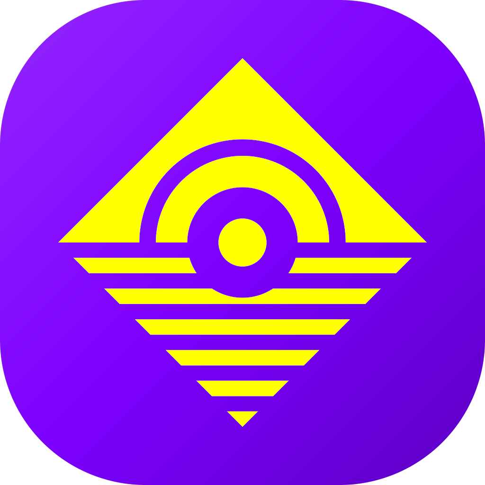
</p>

<h1 align="center">NEFORUM</h1>

<p align="center"><strong>One app, one message, every platform.</strong><br>
A free and open-source cross-poster for Android, iPhone and iPad, macOS, Windows and Linux.</p>

<p align="center">
  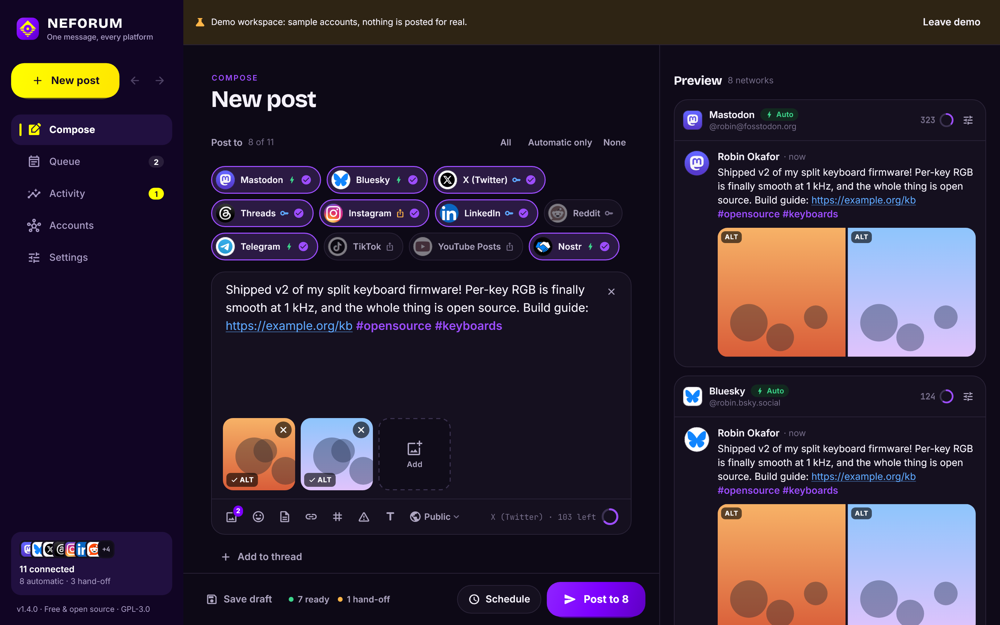
</p>

NEFORUM lets you write a post once and publish it to every network you use, now or on a schedule. It adapts the post for each network (character limits, threads, hashtags, links, media rules) and shows a live preview of every version before anything goes out. It works with 51 platforms, from Mastodon and Bluesky to Instagram, TikTok, YouTube and WordPress.

It does what Buffer, Publer, Metricool, Later or Typefully do for posting, with three differences:

- **Free and open source** (GPL-3.0). No subscription, no per-channel pricing, no NEFORUM account.
- **Every platform works**, including the ones that limit or charge for their API, or only open it to business accounts. Where automatic posting is impossible or paid, NEFORUM hands the finished post to the platform's own app with one tap (see [The three ways to post](#the-three-ways-to-post)).
- **Local-first.** There is no NEFORUM server. Your posts go straight from your device to each network. Keys live in your system keychain. No analytics.

## Download and install

Download NEFORUM from **[neforus.com/neforum](https://neforus.com/neforum/)** or from the **[latest release](https://github.com/Neforuss/NEFORUM/releases/latest)** on GitHub. neforus.com keeps its own copy of every platform's download, so it works without GitHub.

| Platform | Download | How it installs |
|---|---|---|
| Windows | `NEFORUM-Setup-1.4.4.exe` | A normal installer: NEFORUM appears in the Start menu, in Windows search (also Win+R → `neforum`) and in Settings → Apps, and uninstalls cleanly from there. No administrator rights needed; "install for all users" is offered too. Windows 10 or 11, 64-bit. Or `neforum-windows.zip`: unzip and run `NEFORUM.exe`. |
| macOS | `NEFORUM-macOS.dmg` | Open it and drag NEFORUM onto Applications; it then shows up in Launchpad and Spotlight. The app is not signed by Apple, so the first time you open it macOS says it can't check it. Open System Settings → Privacy & Security, scroll down and click **Open Anyway** (on macOS 14 and older, right-click NEFORUM in Applications, then Open). macOS 10.15 or newer. `neforum-macos.zip` has the same app. `NEFORUM-macOS-apple-silicon.dmg` and `NEFORUM-macOS-intel.dmg` are smaller downloads for one kind of Mac. |
| Android | `neforum-android.apk` | Allow installing from your browser or file manager; NEFORUM then sits in the app drawer like any app. Android 7 or newer. Smaller downloads for one kind of phone: `neforum-android-arm64.apk` (nearly every phone), `neforum-android-armv7.apk` (older 32-bit phones), `neforum-android-x86_64.apk` (Chromebooks and emulators). |
| iPhone and iPad | `neforum-ios-unsigned.ipa` | You install this file yourself ("sideloading"): sign it with your own Apple ID in a sideloading app (Feather, AltStore, SideStore or Sideloadly), or build it from source in Xcode. Step by step: [docs/install-iphone.md](docs/install-iphone.md). Install over Wi-Fi: if a sideloading app such as Feather shows 192.0.0.2 or "not connected to the internet" on mobile data, the problem is the sideloading app, not the IPA, and the same file installs on Wi-Fi. |
| Linux | `NEFORUM-x86_64.AppImage` | Make it executable (`chmod +x`) and run it. It works on most distributions from Ubuntu 22.04 on. It updates itself: when the update check finds a new version, **Update now** downloads it from GitHub, checks its SHA-256 and restarts NEFORUM (AppImageUpdate and AppImageLauncher can update it too; see [docs/signing.md](docs/signing.md#appimage-updates)). Or `neforum-linux-x64.tar.gz`: unpack it and run `NEFORUM`. ARM64 builds are in the release too. Needs GTK 3, and a keyring (GNOME Keyring, KWallet or KeePassXC) for your keys. |

The browser extension for Chrome and Firefox comes with the app (Settings → Browser extension → Show extension files) and is also in each release (`neforum-extension-chrome-*.zip`, `neforum-extension-firefox-*.zip`).

Every release file has a build attestation, and each release has a `SHA256SUMS` file, so you can check what you downloaded: `gh attestation verify <file> --repo Neforuss/NEFORUM`. How releases are built and signed is under [Build from source](#build-from-source).

## Your first post

1. **Start NEFORUM.** On a new install it first asks **Do you already use NEFORUM on another device?** If this is your first device, choose **No, I'm new to NEFORUM**. If your other devices use Sync (one encrypted file in your own cloud storage, see [Using several devices](#using-several-devices)), pick where they keep the sync file instead, and this device gets the same accounts, keys, posts and settings. You can join later in Settings → Sync.
2. **Add an account.** Go to **Accounts** and press **Add account**. Pick the platform, then how to post: **Auto**, **Your keys** or **Hand-off** (see [The three ways to post](#the-three-ways-to-post)). Then connect. Each platform has a step-by-step setup guide, shown inside the app and in [docs/platforms](docs/platforms). The quickest to start with are the **Auto** platforms such as Mastodon or Bluesky, or **Hand-off**, which works with any platform and needs no setup at all.
3. **Write the post.** Go to **Compose** and type your text. Paste or drop photos, videos, sound files or documents into the composer if you want them.
4. **Pick where it goes.** In the **Post to** list, choose the accounts. Each network shows a preview of what it will get, with a warning if something does not fit.
5. **Publish.** Press the send button. Its label shows how many accounts you picked (for example **Post to 3**). On a computer, Ctrl+Enter does the same. To post later, press **Schedule** instead and pick a time. For a hand-off account, NEFORUM then opens the platform's app or website with the post ready and you press Post there.

Want to look around first? The demo workspace (Settings → Workspace) has sample accounts and posts, so you can try everything without connecting real accounts.

## The three ways to post

Every connected account uses one of these. You can connect the same platform more than one way.

| | How it works | Good for |
|---|---|---|
| **Auto** | Posts automatically through the platform's open API. No developer keys, no fees, no review. | Mastodon and the fediverse, Pixelfed, Bluesky, Nostr, Misskey, Lemmy, Matrix, Telegram, Discord, WordPress, Ghost, EmDash, DEV, Micropub, Inkbunny |
| **Your keys** | Posts automatically through the official API, using a developer app you create once. NEFORUM tracks the platform's quota and warns you before you hit it. | X, Threads, LinkedIn, YouTube, Reddit, Pinterest, Tumblr, Facebook Pages, Instagram professional accounts, TikTok, Hashnode, DeviantArt, Dribbble, Flickr |
| **Hand-off** | NEFORUM prepares everything: caption on the clipboard, photos in the share sheet, the composer opened with your text. You tap Post. | Any personal account anywhere: Instagram, TikTok, Facebook profiles, YouTube Posts, Snapchat, WhatsApp, Google Business Profile, Substack Notes, Parler, Locals, the art sites without an API (Behance, ArtStation, Cara, pixiv, Itaku, Newgrounds, Fur Affinity, Weasyl, Ko-fi, Artfol, 500px), and every platform above when you'd rather not set up keys |

If an API account runs out of quota (for example X's monthly cap), NEFORUM can fall back to hand-off for that post instead of failing.

### Hand-off on a computer and on a phone

On a computer, a hand-off is click here, paste there. NEFORUM opens the right page with your text already copied: a prefilled composer where the network has one, your channel's Posts tab on YouTube, the photo upload on TikTok. Each photo has a **Copy photo** button, so you add it with Ctrl+V (⌘V on a Mac) wherever the composer takes pasted pictures, and **Copy next** hands out the text, any poll answers and each photo in turn. Websites don't let other apps type into them or drop files on them, so you do the pasting yourself, unless you add the browser extension.

On a phone, after you paste one piece (the text, a poll answer or a photo) in the other app and come back to NEFORUM, the next piece is already copied for you. On Android, **Share** opens the network's own app directly.

### The browser extension (Chrome and Firefox)

Pair the extension once in Settings → Browser extension. After that, **Open** in a hand-off fills in the post on the platform's page: text, poll answers, photos and videos, thread parts included. It works on YouTube Posts (polls and quizzes included), TikTok Studio, Instagram, Substack, Parler, Locals, Facebook, X, Bluesky, Threads, LinkedIn, Pinterest, the art sites and more. You check the post and press Post.

You can also turn on **Post automatically** in Settings → Browser extension. The extension then presses Post itself after a three-second countdown you can stop, and it does this for scheduled posts too while NEFORUM runs on your computer. Automatic posting stays off for X, LinkedIn and Snapchat unless you include them, because their terms forbid scripted posting. Sites that need a choice from you (a Reddit community, a WhatsApp recipient, a Behance cover) are filled in for you to finish. The extension talks only to NEFORUM on your computer. See [docs/browser-extension.md](docs/browser-extension.md).

## Supported platforms

NEFORUM supports 51 platforms. The full matrix (limits, media, quotas, scheduling) is in [docs/platforms.md](docs/platforms.md), generated from the code. Each platform has a step-by-step setup guide in [docs/platforms](docs/platforms), also shown inside the app.

| Kind | Platforms |
|---|---|
| Open networks | Mastodon and compatible servers (Pleroma, Akkoma, GoToSocial, Friendica, Pixelfed, Mitra), Bluesky, Misskey / Sharkey / Firefish / Iceshrimp, Nostr, Lemmy, Matrix |
| Big platforms | X, Threads, Facebook, LinkedIn, Reddit, Tumblr, Parler (hand-off) |
| Photo and video | Instagram, TikTok, YouTube Posts (text and image posts on your channel's Posts tab), Pinterest, Snapchat |
| Video sites | YouTube (videos and Shorts), Odysee (automatic through the LBRY desktop app, or hand-off), Rumble, BitChute |
| Messaging | Telegram channels and groups, Discord (webhooks), WhatsApp |
| Blogs and newsletters | WordPress, Ghost, EmDash, WriteFreely / Write.as, Micropub (IndieWeb, Micro.blog), DEV, Hashnode, Substack Notes, Locals (hand-off) |
| Business | Google Business Profile |
| Art and portfolios | DeviantArt, Dribbble, Pixelfed, Flickr and Inkbunny automatically; Behance, ArtStation, Cara, pixiv, Itaku, Newgrounds, Fur Affinity, Weasyl, Ko-fi, Artfol and 500px by hand-off |

### Limits set by the platforms (as of October 2026)

These limits come from the platforms, not from NEFORUM. The setup guides explain each one.

- **X:** new developer accounts are pay-per-use (about $0.015 per post, $0.20 for a post containing a link). There is no free tier. Hand-off is free.
- **Instagram and Threads (API mode):** Instagram needs a professional (creator or business) account. Both fetch media from a public web address, so you pick a media host in Settings (a free temporary one is built in). An optional fallback host takes over when the main one is down. Hand-off works with any account and needs none of this.
- **Facebook:** the API only posts to Pages you manage. Personal profiles use hand-off.
- **Connecting Meta (Facebook Pages, Instagram, Threads):** you paste a token from Meta's own tools (Graph API Explorer, Instagram's **Generate token**, the Threads User Token Generator), so no redirect address has to be registered. NEFORUM turns it into a long-lived token and renews it when it posts. The setup guides follow Meta's documentation and its App Dashboard as of October 2026, step by step. Publishing your Meta app needs a privacy policy URL: enter NEFORUM's or publish your own from a template ([docs/meta-privacy-policy.md](docs/meta-privacy-policy.md)).
- **Tumblr without API keys:** text, link, quote and chat posts open Tumblr's share tool prefilled. On a computer, photo posts open prefilled too when you have set up a media host; otherwise NEFORUM opens a new photo post and saves the photos to Downloads for you to drag in. With the browser extension, Tumblr's full editor opens and is filled in, files included. Quote, chat and audio posts are a per-post choice.
- **TikTok:** apps TikTok has not audited can only post privately. Hand-off posts publicly from the TikTok app.
- **YouTube Posts** (the text and image posts on a channel's Posts tab) have no API at all, so they use hand-off. On a computer, the browser extension can post them for you when you turn on automatic posting. Your channel needs YouTube's advanced features turned on.
- **YouTube:** uploads from apps that have not passed Google's verification may be locked to private. Google's own pages disagree on whether that still applies, and NEFORUM cannot detect it. Hand-off always posts publicly.
- **Micropub (IndieAuth):** sign-in works on Windows and macOS. On phones, servers that check the app's client page can refuse it until the project publishes that page.
- **Hand-off** always needs one tap from you in the other app, so it cannot run unattended.

## Scheduling without a server

NEFORUM has no server to post for you, so where a scheduled post goes out from depends on the platform and your device:

- **Platforms that can hold a post publish it themselves:** Mastodon (and Pleroma, Akkoma, Friendica, GoToSocial 0.20+), Facebook Pages, YouTube, Tumblr, WordPress and Ghost. NEFORUM hands them the post when you schedule it, so it goes out even if your device is off. If you edit, reschedule, publish now or delete the post in NEFORUM, it takes the platform's copy back first. If that fails (offline, expired sign-in), NEFORUM tells you. Threads, private or unlisted YouTube videos, and times too close or too far out stay on the device.
- **Windows and macOS:** for everything else, NEFORUM keeps running in the tray (menu bar) when you close the window and posts on time. It can start when you sign in.
- **Android:** posts go out in the background within a few minutes of their time.
- **iPhone and iPad:** iOS does not let apps run on a timer. Networks that hold posts need nothing from the phone. For the rest you get a notification at the scheduled time. For a text post, the notification's **Publish now** button tries to post in the few seconds iOS allows without opening the app. A post with photos or video opens NEFORUM, because it can take longer. If you leave the app mid-post, iOS may pause it: on iOS 16.2 and later NEFORUM's Live Activity (its progress on the Lock Screen) says so, and the post continues when you open NEFORUM. A post cannot finish after you swipe the app away.
- **Hand-off accounts** always get a "time to post" reminder.
- **Sign-ins that end before the post:** **Sign-ins** in **Accounts** lists every account by when its sign-in ends and who has to act. NEFORUM warns ahead of the date, and warns in the composer and the queue when a scheduled post falls after it. See [how long each sign-in lasts](docs/sign-in-lifetimes.md).

Two more options in the schedule sheet:

- **A time per network:** schedule X for 9:00 and Instagram for 18:00 from the same post (**Different time per network**). The queue shows the post as partly published until every network has it.
- **A random time:** **Pick a random time** draws any minute from the next 24 hours, 7, 30, 90 or 365 days, or days you choose, at least 15 minutes ahead. Every minute that really exists is equally likely, so a clock change cannot produce a time that does not exist. **Try another** draws again as often as you like, and nothing changes until you press **Schedule**. See [docs/scheduling.md](docs/scheduling.md).

## Using several devices

**Sync** keeps accounts, keys, posts and settings the same on every device, through one encrypted file in storage you already have, the way KeePassXC shares a database. Turn it on in **Settings → Sync**. Every device then reads and writes `NEFORUM.neforumsync` (Argon2id + AES-256-GCM) in one of these places:

- a folder your cloud app syncs (OneDrive, Google Drive, Dropbox, iCloud Drive, Syncthing, Nextcloud and others);
- a WebDAV server or an S3-compatible bucket;
- Google Drive directly, on every device, through its API with your own Google Cloud key (Google Drive's iPhone app does not let other apps pick its folders);
- on phones and tablets, a folder or the sync file in iCloud Drive, Dropbox and other cloud apps, picked through the system file picker.

How it merges:

- Each account, post and setting merges on its own. When both sides changed the same thing, a post that already went out beats an edit, and the newest renewed sign-in wins.
- X and Tumblr end the old sign-in on every renewal, so they get one renewer at a time: the renewed keys travel through the file, and a refused renewal reads the file again and retries. TikTok, DeviantArt and Pixelfed work the same way. Tumblr can also connect with OAuth 1.0a keys, and so can X until X stops accepting them on 31 January 2027. See [how long each sign-in lasts](docs/sign-in-lifetimes.md).
- A scheduled post is published by the device it was scheduled on (that device has the photos). Another device steps in only when that one has been silent and the post is 30 minutes overdue.

To check that two devices match, open **Connection** on an account card in **Accounts**. It shows how the account is set up: its server or instance, your own app or client ID, its Page, board or channel, when the sign-in runs out, which keys this device holds, and whether they are **Synced** or **Only on this device**. **Copy setup** or **Copy all setups** puts that in your clipboard to compare. It never shows a key, password or token. More in [docs/sync.md](docs/sync.md).

Moving to a new phone or computer instead? **Move to another device** carries every account and its keys there in one encrypted file, with no cloud involved ([docs/backup.md](docs/backup.md)).

## More features

<p align="center">
  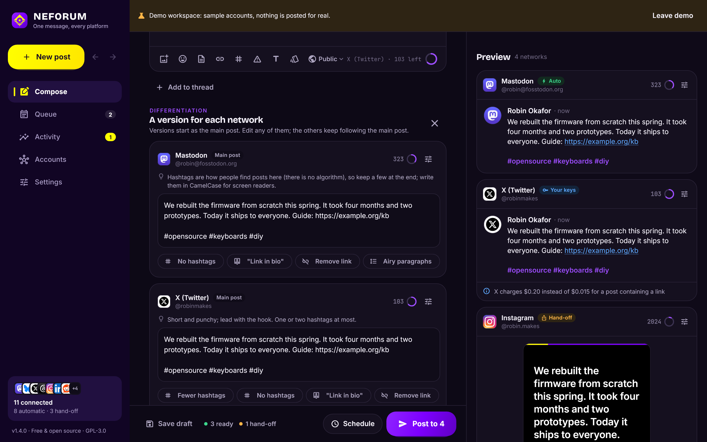
</p>

### Writing and editing

- Paste screenshots and copied photos straight into the composer (Ctrl+V, or ⌘V on a Mac).
- On a computer, zoom everything in or out like a web page (Ctrl + and Ctrl −, ⌘ on a Mac, or Ctrl + mouse wheel).
- Go back and forward through the pages you visited with a mouse's side buttons, Alt+Left and Alt+Right (⌘[ and ⌘] on a Mac), or the arrows beside **New post**.
- The post you are writing is kept when you close NEFORUM, until you publish or schedule it.
- Write a thread part by part with **+ Add to thread**. Give each part its own photos and videos with the part's own **Add media**, or keep one media tray for the whole post (Settings → Posting → Media in a thread). Move a part up or down with its arrows (its media goes with it), and clear a part or the whole post with its **X** button (with Undo).
- Cancel a post while it is being published.
- Once every network has a post, NEFORUM deletes it and its photos by default (Settings → Activity and history), so nothing you published stays on your device.

### A version for each network (DIFFERENTIATION)

What works on X rarely works on LinkedIn or Instagram. NEFORUM calls per-network versions DIFFERENTIATION. Under the editor, **Differentiate** opens one editable version per network, side by side, each with that network's counter and a tip on its conventions. Each version has one-tap changes: fit to the limit, hashtags to the end, fewer or no hashtags, "link in bio", remove the link, airy paragraphs. Each network can also get its own title, link and choice of photos from the album (one photo may suit one network's rules and not another's). Versions you don't touch keep following the main post. All of this is plain text work on your own words: nothing is generated or sent anywhere.

### Photos that fit every network

Instagram's API takes photos from 4:5 to 1.91:1 and only JPEGs; other networks have their own size and pixel limits. Instead of refusing the post, NEFORUM makes an adjusted copy for the network that needs it, and every other network gets the original. You choose how in Settings: soft borders from a blur of the photo, a **colour fill** with the photo's own dominant colours flowing from its edges (like Instagram stories, no black bars), or a crop.

- **Fill the whole frame** (on by default for TikTok and Instagram) fits photos to the frame those apps show them in, TikTok 9:16 and Instagram 4:5 (stories 9:16), so nothing is cut off. The preview shows exactly what each network gets.
- **Caption on photo** (Instagram and TikTok, off by default) writes the caption on the first photo in the network's own font (TikTok Sans, bundled; Instagram Sans when installed), on a dark label placed clear of the app's buttons. The caption editor (tap the pill under the preview, or Settings → Text cards for the default) changes the words on the photo and puts them at the top, middle or bottom, or in a **block above the photo** (the network's whole frame, with the photo scaled to fit below). It also sets the size, colours, background, alignment and font, with a live preview. A video gets the caption in a block above it: NEFORUM makes a copy of the video in the network's 9:16 frame on your device (Windows, macOS, Android, iPhone and iPad), and the copy keeps its sound. Where that is not possible, the original goes out unchanged.
- **Videos that are too big** for a network are flagged in the composer with the network and how far over the size they are. Turn on **Shrink videos that are too big for a network** (Settings → Posting, off by default) and NEFORUM makes one smaller copy per size limit on your device, just under each network's own limit. Networks where the video fits get the original. Video thumbnails show a frame from the video.

### Text cards for photo-only networks

Instagram, Pinterest, TikTok photo posts and Snapchat refuse a post without an image. When a post is only words, NEFORUM sets them on a plain card, white on black or black on white, with the same signature every time: a purple rule with a yellow tab along the top, and the NEFORUM mark, wordmark and your handle at the bottom. The card is made on your device when you save or schedule the post. It goes only to the networks that need it (the others get plain text) and carries the words as alt text. The caption still has the full text, hashtags and link.

<p align="center">
  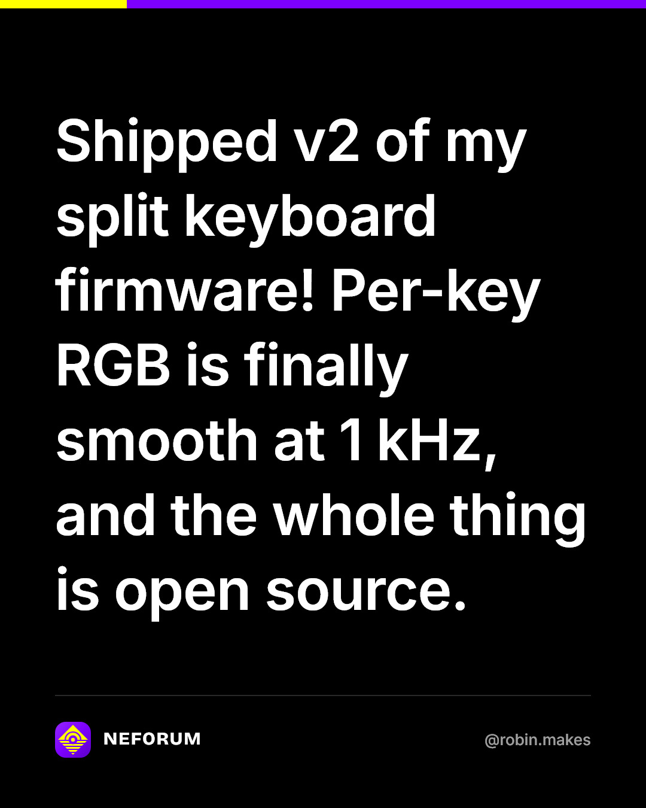
  &nbsp;
  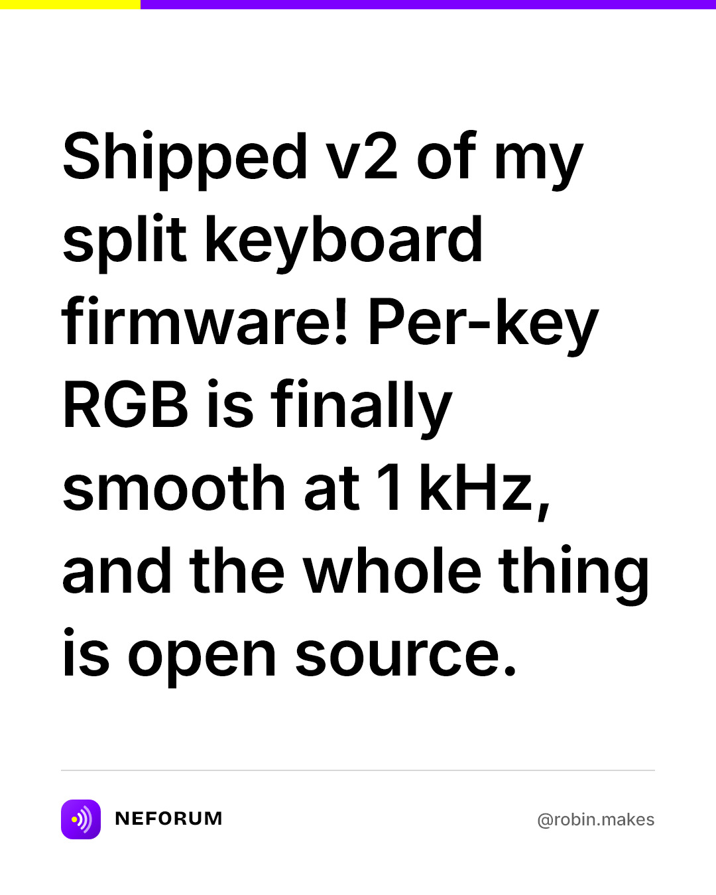
</p>

- Pick the style and the font per post under the preview: NEFORUM's own Inter, or each network's own (TikTok Sans or Instagram Sans, Times New Roman or Arial). Set the defaults in Settings → Text cards, or turn cards off there.
- The signature is optional per network: turn it off (for example only for Instagram) under the preview or in Settings → Text cards, and the card keeps just your words and handle. Your @handle is optional per network too.
- Line the words up left, centred, right, justified or **distributed** (every line spread across the card, the last one too).
- Instead of a plain colour, a card can set your words over a photo, either one of the post's or one picked only for the card, blurred and dimmed as you like, with white, black or automatic text and an optional box behind the words. The photo is not posted by itself.
- **Save image** under the preview saves the card as a JPEG (into `Downloads\NEFORUM\Text cards` on a computer, through the share sheet on a phone). In a hand-off, **Save media to Downloads** saves the post's photos and cards with readable names and opens the folder, ready to drag into Instagram or TikTok on the web.

### Fonts and card designs

Captions and text cards can use any font installed on your device, a font file you import, or a free font you find and download inside the font picker (only if you allow it; see [Privacy](#privacy)).

**Design card** opens one designer for text cards and for the pictures of the still-picture videos made from sound files (see [Sound files](#sound-files)). It offers ten templates (Minimal, Bold poster, Vinyl, Gradient wave, Photo overlay, Newspaper, Neon, Polaroid…) or your own saved ones; backgrounds in colours, gradients, photos, patterns and grain; cover art as a square, circle or vinyl record; a waveform of the track; and text blocks, each with its own font, size, weight, spacing, outline, shadow and place on the card. Every network previews its own card.

When several networks get a card, **Text card for every network** above the previews sets the design, font, signature, @handle and the post text sent alongside the card for all of them at once. It says what still differs between them and makes them match in one tap. It also:

- writes your own @handle on every card (left empty, each network shows its own; a network whose **Show @handle** is off keeps it off) and sets its size, colour and place (a corner, or the middle of the top or bottom edge);
- sets the words' size, line spacing, colour and place (top, middle or bottom);
- sets the card's colour and its margins, on the classic card and on a card design alike (on a design, they change the design itself).

Colours come from swatches, the colour wheel or a hex code. The words' place (top, middle or bottom) is the same setting as the background photo's. The background photo's own text colour choices (Automatic, White or Black) belong to the photo, and when you go back to a plain card, NEFORUM never leaves words or a handle that the plain card cannot show.

On a design, the words and handle you place go where there is no picture (the record, a framed photo, the waveform) and none of the design's own text, on every card shape. The design's own text stays where the design puts it. Your words are never printed over a picture: a post too long for the room left is cut at a readable size, and if the margins leave no room the words are left off, with a warning under the card that says what helps. When a larger size changes nothing, the warning says so. With one network, **Text & @handle…** under its card opens the same controls.

The choices are saved with the post, so scheduled, reopened and synced posts make the same cards, and a card you never restyle keeps the standard look ([how it works](docs/text-cards.md)). A card's background photo can be moved and zoomed, turned, adjusted (brightness, contrast, saturation, black and white), tinted, and given a gradient or vignette, with the words at the top, middle or bottom. **Use the text card on every network** sends the same card to every network that takes images, with or without the text alongside.

### Sound files

NEFORUM takes MP3, M4A, WAV, FLAC, AIFF, Ogg and Opus files. A voice note or a track goes:

- as playable sound to Telegram, Discord, Matrix, Mastodon, Misskey, WordPress, Ghost and Odysee;
- as a still-picture video (your first photo or a title card) to X, Bluesky, Instagram, TikTok, YouTube and the other video-only networks;
- as a link on your media host to Reddit, Lemmy, Nostr and the blogs.

**Standard** sends one MP3 (M4A on phones and Macs). **Lossless** sends your original WAV, FLAC, AIFF or Apple Lossless file untouched where the network keeps it. See [docs/audio.md](docs/audio.md).

**Track details:** a file's title, artist, album, year, genre, track number and cover, as Mp3tag and similar programs write them (ID3, FLAC and Ogg comments, MP4 tags, WAV and AIFF chunks), go wherever a network shows them: Telegram's player, Mastodon's cover thumbnail, the file name on Discord, the media title on blogs, and the cover as the picture of the still-picture video. NEFORUM keeps them, cover included, in the MP3 or M4A copy it makes. Edit every detail in **Track details** on the sound file, whether the file has tags or not, and let the post text come from a template such as `{artist} – {title} ({album}, {year})`.

### Threads from documents and photo dumps

- **Documents into threads** (PDF, Word .docx, EPUB, Markdown, text, HTML): drop a document on the composer and NEFORUM reads it on your device in reading order (it handles columns, running headers and page numbers) and turns it into a draft thread. Each picture goes in the part next to the text it sits beside, with its caption as alt text. You check and edit the thread; nothing is posted until you say so.
- **Photo dumps into threads:** drop more photos and videos than a network takes in one post (20 holiday photos, say) and nothing is left out. Each network gets them split by its own limits, in your order. On X, Bluesky, Mastodon and Misskey they go in further posts of the thread (20 photos on X are 5 posts of 4). Where they fit, they go in one carousel (Threads takes 20). Everywhere else they go in a numbered series of separate posts, one after the other (Instagram: 2 posts of 10). The preview shows every post, alt text stays with its photo, and if you number your thread posts, the numbering counts the extra posts too. If a thread or series breaks off partway, the posts already live are recorded and **Retry** posts only the rest. Hand-offs are one post: what does not fit is listed, never dropped silently.

### Paragraphs linked to photos

In one long post with several photos or videos, **Link paragraphs to media** (under the photos) lets you say which paragraph is about which ones: tap a paragraph's link button, then the photos it is about, one or several. It stays off until you link something, and when nothing is linked, networks get the post the usual way.

- Telegram and Discord get each paragraph with its own photos as messages in a row (the paragraph as the caption when it fits).
- Tumblr puts each paragraph's media right after it in the post.
- Facebook, LinkedIn and Instagram take one post: the photos go in the order of their paragraphs, and each linked paragraph ends with their numbers, such as "(1/3)", or "(2-3/3)" for a paragraph about two of them. With the caption on photos, each Instagram photo and story frame that starts a paragraph's photos gets that paragraph's words.

The links move with their paragraphs as you edit the text, and they are saved and synced with the post.

### Articles for blogs

With a blog among the networks (WordPress, Ghost, EmDash, WriteFreely, DEV, Hashnode, Micropub, Tumblr, Substack), switch the composer from **Post** to **Article** and write the post as blocks: paragraphs, headings, photos and galleries placed anywhere between them, videos, sound, embeds, quotes, lists, code and dividers. The editor has bold, italic, code and links (Ctrl+B, Ctrl+I, Ctrl+E, Ctrl+K on a computer), drag to reorder, captions, alt text and credits, and a cover, subtitle, excerpt, address, tags, canonical URL and draft or publish.

Each blog gets the article in its own format (WordPress blocks, Ghost cards, Portable Text, Markdown, NPF, Micropub HTML). Its preview lists what that blog leaves out or changes before you post, and you can leave blocks out of each blog. The social networks of the same post get the short version, and X can get an X Article. Switching back to **Post** loses nothing. See [docs/articles.md](docs/articles.md).

### Stories, polls and artwork

- **Stories and posts:** on Instagram and Facebook Pages, choose **Post**, **Story** or **Post + Story** right on the network's preview. The choice sticks for that account's next posts. A story gets its own 9:16 copies (and a full-screen text card for words only), and NEFORUM tracks both together.
- **Polls and quizzes:** the **Poll** button adds a text poll, an image poll or a quiz for networks that have them (YouTube Posts today). The post text is the question; other networks get the post without the poll. In the hand-off every answer has its own copy button.
- **Artwork for art sites:** turn on **Artwork** under **Post to**, and the post goes only to your art sites (DeviantArt, ArtStation, Behance, pixiv and the others listed under [Supported platforms](#supported-platforms)). The post's title and tags become the work's title and tags, and its text the description. Set the rating (general, mature or adult), mark work made with AI, and ask the sites not to train AI on it where they offer that. Art sites never receive text cards, and ordinary posts leave them out.

### Emoji, symbols and kaomoji

The emoji button in the editor opens a sheet with search, your recent emoji and a skin tone row, and puts each pick at the cursor of the field you were in: the post, a thread part, a title, a network's own version, the words on a photo or a card, poll answers, alt text and track details. On a computer it stays open while you pick; on a phone it opens over the composer, beside the keyboard's own emoji key. The sheet works without a network connection, and your recent emoji and skin tone stay on the device.

The sheet has four tabs:

- **Emoji** has every current emoji with skin tones.
- **Symbols** has about 5,600 Unicode symbols: sets such as Hearts, Stars, Arrows, Currency and Zodiac, plus 43 whole Unicode blocks (box drawing, chess, playing cards, Braille and more). Each character shows its name, code point and HTML code, and on Windows its Alt code.
- **Kaomoji** has over 300 kaomoji sorted by feeling, and a builder where you pick arms, face, eyes and mouth.
- **Text styles** turns the selected text into bold, italic, script, fraktur, double-struck, monospace, fullwidth, circled, squared, small capitals, superscript, upside down, strikethrough, underline and more, using Unicode's own characters.

Search works in every tab. Long press or right-click anything to add it to your favourites, which sync with your other settings. A character this device has no font for is left out, so the panel never shows an empty box.

What you insert goes into your post exactly as picked. If it takes a network over its limit (styled letters count double on X), that network says so and the others are unaffected. On Markdown networks NEFORUM escapes the kaomoji, so `¯\_(ツ)_/¯` keeps its arm on Reddit, Lemmy and Discord. Screen readers read styled letters badly, so keep them to a word or two.

Cards draw emoji in colour with your device's own emoji font. An emoji your device cannot draw is left off the picture with a message, rather than drawn as a blank box, and the post's text keeps it ([how it works](docs/text-cards.md#emoji-on-a-card)).

### Appearance

Pick one of six accent colours or any colour on the colour wheel. Put a picture of your own behind the pages (sharp or blurred, dimmed as much as text needs to stay readable). Give the sidebar any colour of your own or make it **See-through**, with its own tint, opacity and frosted-glass blur. NEFORUM keeps the labels on every colour readable, shows every option that is on with a solid fill and a check mark, and follows your system's high-contrast and reduce-motion settings. There are light and dark themes, and layouts for phones, tablets and wide desktop windows.

### Update check

NEFORUM asks once whether to look for new versions. If you say yes, it downloads one public file from neforus.com at most once a day and compares versions on your device. It sends no version, device or ID, and it never installs anything by itself.

## More screenshots

<p align="center">
  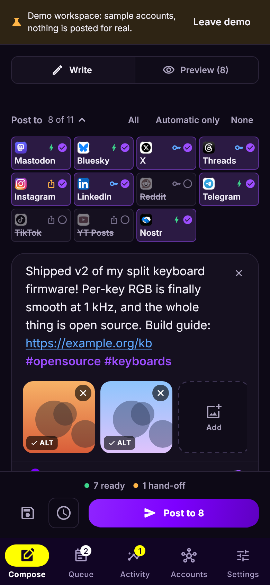
  &nbsp;
  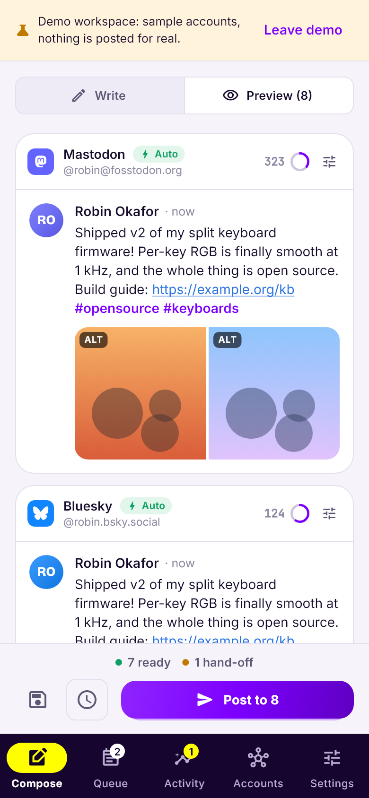
  &nbsp;
  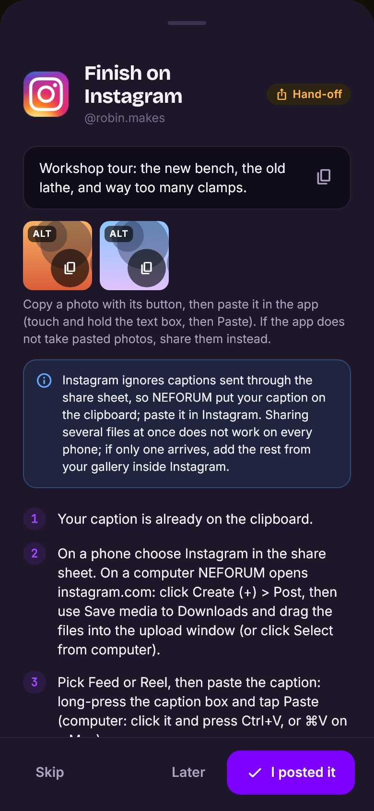
</p>

| | |
|---|---|
| 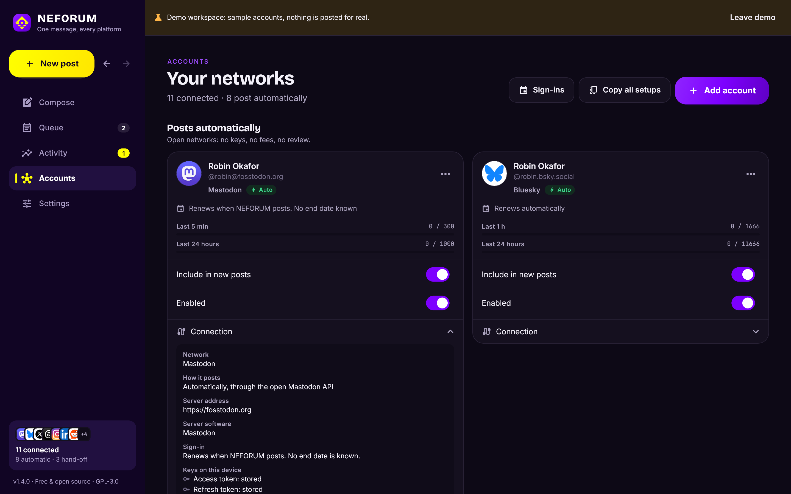 | 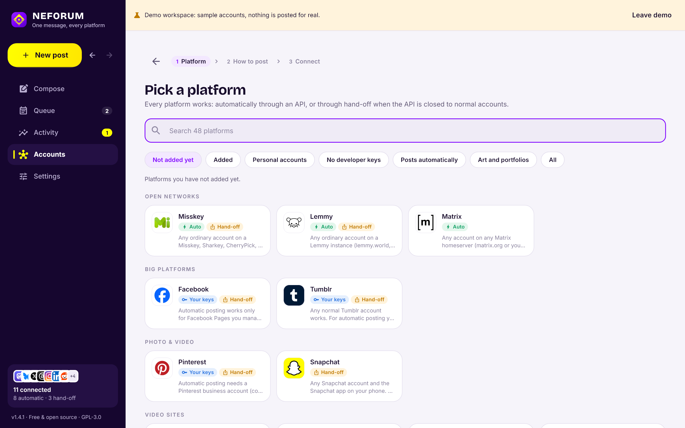 |
| 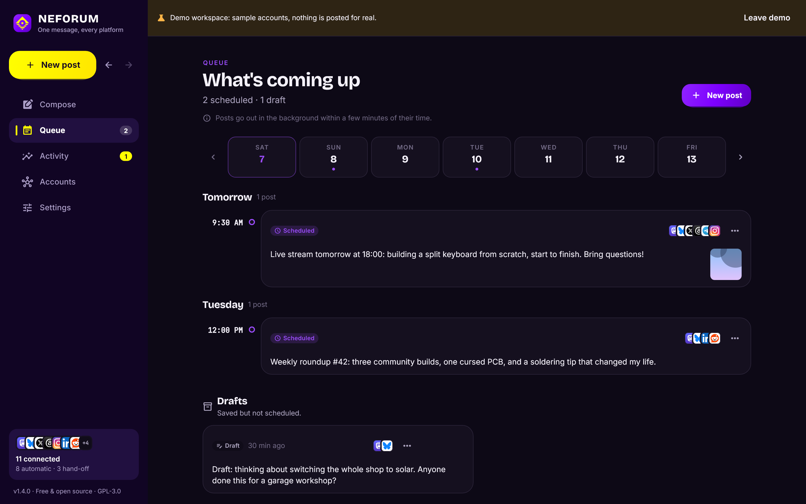 | 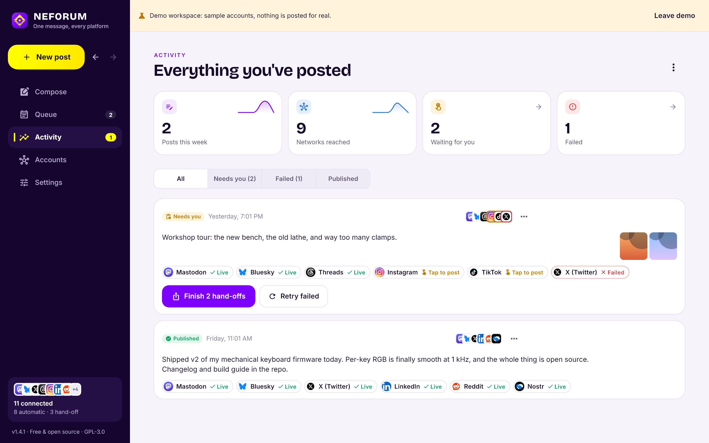 |
| 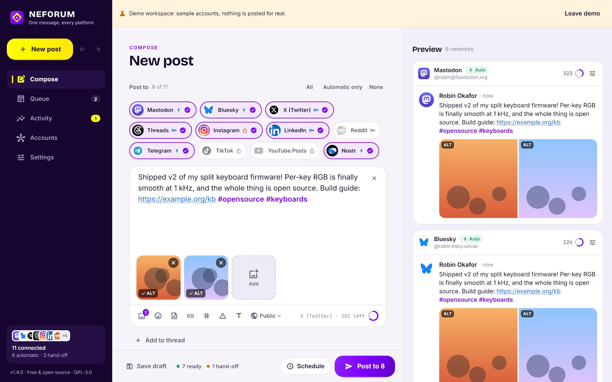 | 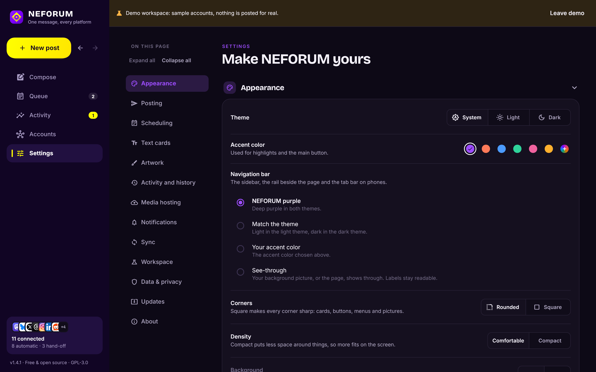 |

## Privacy

NEFORUM has no backend. It stores accounts, posts and settings in your app data folder and secrets in the OS keychain (Keychain on Apple platforms, Keystore on Android, DPAPI on Windows).

Network traffic goes only to the platforms you post to and, if you pick them, the media host and fallback host you configure, the storage you sync through (which only ever receives the encrypted sync file), neforus.com if you turn on the update check (and github.com when you press Update now in the Linux AppImage), and api.fontsource.org and cdn.jsdelivr.net if you turn on font downloads. Those two see your IP address and the font names you look up, never your posts.

Settings → Data and privacy has three tools:

- **Move to another device** saves your accounts with their keys, media hosts, settings and drafts in one file encrypted with a passphrase (Argon2id and AES-256-GCM). You carry it to your phone or another computer yourself and import it there (see [docs/backup.md](docs/backup.md)).
- **Export posts** saves a readable JSON file of your posts and account list without any keys.
- **Delete everything** removes all accounts, keys, posts and downloaded fonts from the device.

Backup files you made are your own copies: deleting your data in NEFORUM does not delete them.

## Build from source

You need [Flutter 3.47](https://docs.flutter.dev/get-started/install) (Dart 3.13), plus the usual toolchain for your target: Android SDK, Xcode on a Mac for iOS and macOS, Visual Studio 2022 with "Desktop development with C++" for Windows, or for Linux clang, CMake, Ninja, pkg-config and the GTK 3, libsecret and WebKitGTK 4.1 development packages.

```bash
git clone https://github.com/Neforuss/NEFORUM.git
```

```bash
cd NEFORUM/apps/neforum_app && flutter pub get && dart run tool/sync_docs.dart
```

Then run one of the commands below. Android and iOS builds take
`--dart-define=NEFORUM_MOBILE=true`, which leaves out the desktop tray code
(its FFI bindings break the release compiler for phones).

```bash
flutter build apk --release --dart-define=NEFORUM_MOBILE=true
```

```bash
flutter build windows --release
```

Then, for the Windows installer (needs [Inno Setup 6](https://jrsoftware.org/isinfo.php)):

```bash
iscc installer\neforum.iss
```

```bash
flutter build macos --release
```

```bash
flutter build ios --release --dart-define=NEFORUM_MOBILE=true
```

```bash
flutter build linux --release
```

Every push builds all platforms with [GitHub Actions](.github/workflows/build.yml). A version tag (`v1.4.4`) builds them into a release, which stays a draft until the version is on neforus.com and is then published, with a build attestation for every file (`gh attestation verify <file> --repo Neforuss/NEFORUM`) and `SHA256SUMS`. Code signing is set up through free routes only; see [docs/signing.md](docs/signing.md).

## Project layout

```
packages/neforum_core   Pure-Dart core: data model, 51 platform adapters, text
                        adaptation (counting, threads), quota tracking, OAuth,
                        media hosts, publish service, scheduler, encrypted
                        backup and sync. No Flutter.
apps/neforum_app        Flutter app: design system, screens, keychain storage,
                        sign-in, notifications, background work, tray.
docs/platforms          Per-platform setup guides (bundled into the app).
docs/research           The API research the adapters were built from.
docs/design/STYLE.md    Design rules for contributors.
```

Run the tests:

```bash
cd packages/neforum_core && dart test
```

```bash
cd apps/neforum_app && flutter test --exclude-tags screenshots
```

On a desktop, also run the real app with its native plugins (window, tray, keychain, notifications) against a throwaway data folder:

```bash
cd apps/neforum_app && flutter test integration_test -d windows
```

The core has over 1,000 tests. They pin every adapter's requests and error handling against mocked APIs, including server-side scheduling and taking a scheduled post back. The app tests render every screen at phone, tablet, desktop and ultrawide sizes in both themes, and drive the main flows end to end, text cards and platform-held schedules among them.

## Character catalog

The Symbols and Text styles tabs and the search words for emoji and symbols come from JSON files in `packages/neforum_core/assets/characters`. `tool/generate_character_catalog.dart` makes them from pinned Unicode files: `Blocks.txt`, `UnicodeData.txt` and `NamesList.txt` from the Unicode Character Database, Unicode's CP437, CP1252 and IBMGRAPH tables for Alt codes, and the CLDR English annotations. The tool checks each file against the SHA-256 it holds, and each JSON file records the versions and hashes it was made from. Nothing is typed by hand: block ranges, names, the styled alphabets and the Letterlike Symbols that fill their gaps (script B is U+212C) all come from those files. The kaomoji (`lib/src/characters/kaomoji.dart`) and the upside-down pairs were written for NEFORUM.

To move to a new Unicode version:

1. In `packages/neforum_core/tool/generate_character_catalog.dart`, set `kUnicodeVersion` (and `kCldrVersion` for a new CLDR release) and empty the `sha256` of each source that changes.
2. Delete `packages/neforum_core/.dart_tool/character_sources`, then run `dart run tool/generate_character_catalog.dart` in `packages/neforum_core`. It downloads the files, prints a `PIN` line with the hash of each one that has no hash, and writes the JSON files and the `Blocks.txt` and `UnicodeData.txt` copies the tests read.
3. Paste the printed hashes into the tool and run it again: it now checks them.
4. Update `test/fixtures/unicode/emoji-test.txt` to the same version and run `dart run tool/generate_emoji_tables.dart`, so emoji counting and the catalog agree.
5. Run `dart test test/characters test/text`. The gate tests compare every block with `Blocks.txt`, every cell and style with `UnicodeData.txt`, and send each character through every network's text path. A failure names what Unicode changed.

## License

NEFORUM is free software under the [GNU General Public License v3](LICENSE). Fonts: Inter, Bricolage Grotesque and JetBrains Mono (SIL Open Font License). A font you download through NEFORUM keeps its own open licence, stored next to the font on your device. The emoji sheet's data comes from the `unicode_emojis` package (MIT). The symbols, text styles and search words come from the Unicode Character Database and Unicode CLDR (Unicode License v3); see [THIRD_PARTY_NOTICES.md](THIRD_PARTY_NOTICES.md), also shown in the app under Settings, About, Licenses. The counter's tests use twitter-text's conformance file (Apache-2.0, kept with its licence in `packages/neforum_core/test/fixtures/twitter_text`) and Unicode's `emoji-test.txt`. Platform logos come from Font Awesome Brands (CC BY 4.0) and belong to their owners; NEFORUM is not affiliated with any of the platforms it posts to.
