<p align="center">
  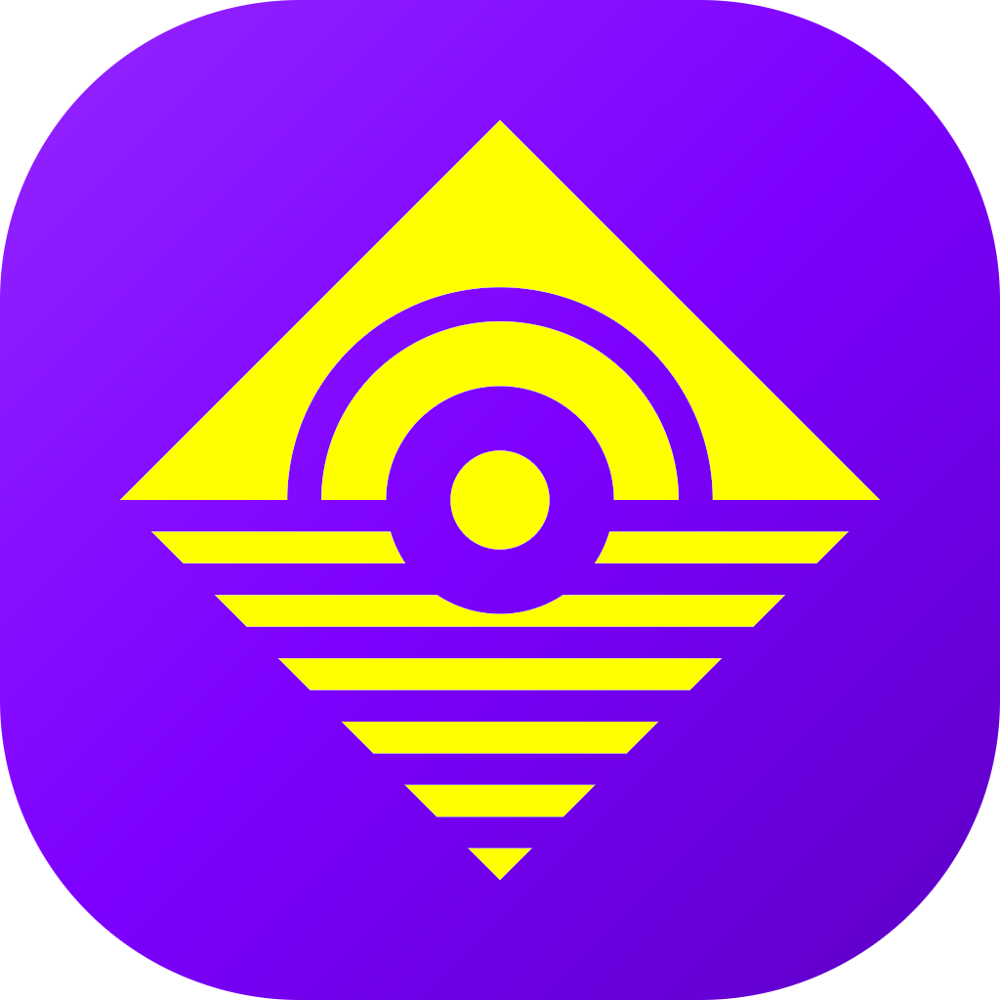
</p>

<h1 align="center">NEFORUM</h1>

<p align="center"><strong>One app, one message, every platform.</strong><br>
A free and open-source cross-poster for Android, iPhone and iPad, macOS and Windows.</p>

<p align="center">
  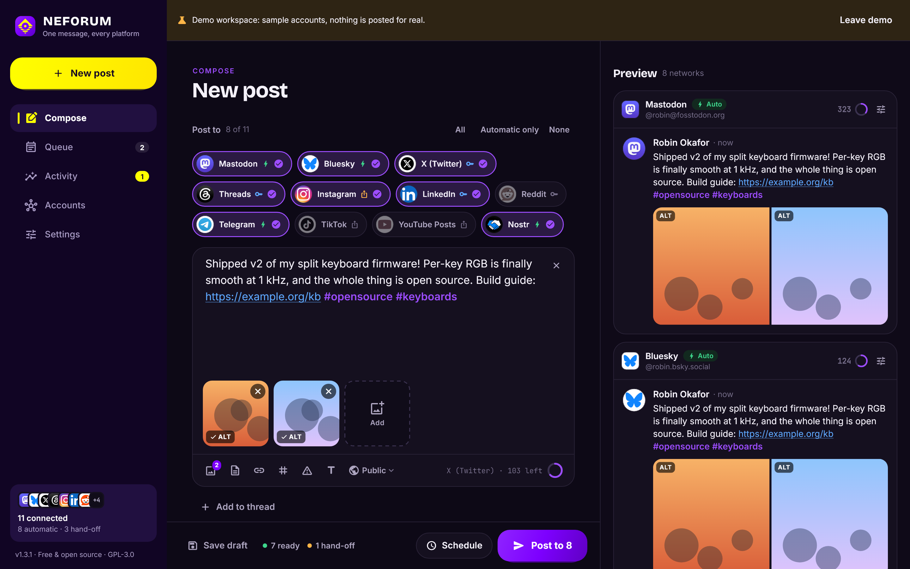
</p>

Write a post once. NEFORUM adapts it for each network (character limits, threads, hashtags, links, media rules), shows you a live preview of every version, and publishes it everywhere at once or on a schedule. Paste screenshots and copied photos straight into the composer (Ctrl+V, or ⌘V on a Mac), zoom everything in or out like a web page on a computer (Ctrl + and Ctrl −, ⌘ on a Mac, or Ctrl + mouse wheel), and the post you are writing is kept when you close NEFORUM, until you publish or schedule it. Write a thread part by part with **+ Add to thread**, clear a part or the whole post with its **X** (with Undo), and cancel a post while it is being published. Once every network has a post, NEFORUM deletes it with its photos by default (Settings → Activity and history), so nothing you published stays on your device. Using several devices? **Sync** keeps accounts, keys, posts and settings the same everywhere through one encrypted file in storage you already have (OneDrive, Google Drive, Dropbox, iCloud Drive, Syncthing, Nextcloud and other WebDAV servers, S3 buckets), the way KeePassXC shares a database. Moving to a new phone or computer instead? **Move to another device** carries every account and its keys there in one encrypted file, no cloud involved.

It does what Buffer, Publer, Metricool, Later or Typefully do for posting, with three differences:

- **Free and open source** (GPL-3.0). No subscription, no per-channel pricing, no NEFORUM account.
- **Every platform works**, including the ones that limit or charge for their API, or only open it to business accounts. Where automatic posting is impossible or paid, NEFORUM hands the finished post to the platform's own app with one tap (see below).
- **Local-first.** There is no NEFORUM server. Your posts go straight from your device to each network. Keys live in your system keychain. No analytics.

## The three ways to post

Every connected account uses one of these. You can connect the same platform more than one way.

| | How it works | Good for |
|---|---|---|
| **Auto** | Posts automatically through the platform's open API. No developer keys, no fees, no review. | Mastodon and the fediverse, Pixelfed, Bluesky, Nostr, Misskey, Lemmy, Matrix, Telegram, Discord, WordPress, Ghost, DEV, Micropub, Inkbunny |
| **Your keys** | Posts automatically through the official API, using a developer app you create once. NEFORUM tracks the platform's quota and warns you before you hit it. | X, Threads, LinkedIn, YouTube, Reddit, Pinterest, Tumblr, Facebook Pages, Instagram professional accounts, TikTok, Hashnode, DeviantArt, Dribbble, Flickr |
| **Hand-off** | NEFORUM prepares everything: caption on the clipboard, photos in the share sheet, the composer opened with your text. You tap Post. | Any personal account anywhere: Instagram, TikTok, Facebook profiles, YouTube Posts, Snapchat, WhatsApp, Google Business Profile, Substack Notes, the art sites without an API (Behance, ArtStation, Cara, pixiv, Itaku, Newgrounds, Fur Affinity, Weasyl, Ko-fi, Artfol, 500px), and every platform above when you'd rather not set up keys |

If an API account runs out of quota (for example X's monthly cap), NEFORUM can fall back to hand-off for that post instead of failing.

On a computer a hand-off is click here, paste there: NEFORUM opens the right page (a prefilled composer where the network has one, your channel's Posts tab on YouTube, the photo upload on TikTok), with your text already copied. Each photo has a **Copy photo** button, so you add it with Ctrl+V (⌘V on a Mac) wherever the composer takes pasted pictures, and **Copy next** hands out the text, any poll answers and each photo in turn. Websites don't let other apps type into them or drop files on them, so the paste itself stays yours, unless you add the browser extension. On a phone, after you paste one part in the other app and come back to NEFORUM, the next part is already copied for you; on Android, **Share** opens the network's own app directly.

**NEFORUM browser extension (Chrome and Firefox).** Pair it once in Settings → Browser extension, and **Open** in a hand-off fills in the post on the platform's page: text, poll answers, photos and videos, on YouTube Posts (polls and quizzes included), TikTok Studio, Instagram, Substack, Facebook, X, Bluesky, Threads, LinkedIn, Pinterest, the art sites and more, thread parts included. You check it and press Post. Or turn on **Post automatically** in Settings → Browser extension: the extension then presses Post itself after a three-second countdown you can stop, also for scheduled posts while NEFORUM runs on your computer. It stays off for X, LinkedIn and Snapchat unless you include them, because their terms forbid scripted posting, and sites that need your own choice (a Reddit community, a WhatsApp recipient, a Behance cover) are filled in for you to finish. It talks only to NEFORUM on your computer. See [docs/browser-extension.md](docs/browser-extension.md).

### Text cards for photo-only networks

Instagram, Pinterest, TikTok photo posts and Snapchat refuse a post without an image. When a post is only words, NEFORUM sets them on a plain card, white on black or black on white, with the same signature every time: a purple rule with a yellow tab along the top, and the NEFORUM mark, wordmark and your handle at the bottom. The card is made on your device when you save or schedule the post. It goes only to the networks that need it (the others get plain text) and carries the words as alt text. The caption still has the full text, hashtags and link. Pick the style and the font (NEFORUM's own Inter, each network's own: TikTok Sans or Instagram Sans, Times New Roman or Arial) per post under the preview, set the defaults in Settings → Text cards, or turn cards off there.

The signature is optional per network: turn it off (for example only for Instagram) under the preview or in Settings → Text cards, and the card keeps just your words and handle. Your @handle is optional per network too. Line the words up left, centred, right, justified or **distributed** (every line spread across the card, the last one too). Instead of a plain colour, a card can set your words over a photo, one of the post's or one picked only for the card, blurred and dimmed as you like, with white, black or automatic text and an optional box behind the words; the photo is not posted by itself. **Save image** under the preview saves the card as a JPEG (into `Downloads\NEFORUM\Text cards` on a computer, through the share sheet on a phone), and in a hand-off **Save media to Downloads** saves the post's photos and cards with readable names and opens the folder, ready to drag into Instagram or TikTok on the web.

### DIFFERENTIATION: a version for each network

What works on X rarely works on LinkedIn or Instagram. Under the editor, **Differentiate** opens one editable version per network, side by side, each with that network's counter and a tip on its conventions. One-tap changes per version: fit to the limit, hashtags to the end, fewer or no hashtags, "link in bio", remove the link, airy paragraphs. Each network can also get its own title, link and choice of photos from the album (one photo may suit one network's rules and not another's). Versions you don't touch keep following the main post; all of it is plain text work on your own words, nothing is generated or sent anywhere.

### Photos that fit every network

Instagram's API takes photos from 4:5 to 1.91:1 and only JPEGs; other networks have their own size and pixel limits. Instead of refusing the post, NEFORUM makes an adjusted copy for the network that needs it, and every other network gets the original. Choose how in Settings: soft borders from a blur of the photo, a **colour fill** with the photo's own dominant colours flowing from its edges (like Instagram stories, no black bars), or a crop.

**Fill the whole frame** (on by default for TikTok and Instagram): photos are fitted to the frame those apps show them in, TikTok 9:16 and Instagram 4:5 (stories 9:16), so nothing is cut off. The preview shows exactly what each network gets.

**Caption on photo** (Instagram and TikTok, off by default): the caption is written on the first photo in the network's own font (TikTok Sans, bundled; Instagram Sans when installed), on a dark label placed clear of the app's buttons. The caption editor (tap the pill under the preview, or Settings → Text cards for the default) changes the words on the photo, puts them at the top, middle or bottom, or in a **block above the photo** (the network's whole frame with the photo scaled to fit below), and sets the size, colours, background, alignment and font, with a live preview. A video gets the caption in a block above it: NEFORUM makes a copy of the video in the network's 9:16 frame on your device (Windows, macOS, Android, iPhone and iPad), keeping its sound; the original goes out unchanged where that is not possible.

**Sound files** (MP3, M4A, WAV, FLAC, AIFF, Ogg, Opus): a voice note or a track goes as playable sound to Telegram, Discord, Matrix, Mastodon, Misskey, WordPress, Ghost and Odysee, as a still-picture video (your first photo or a title card) to X, Bluesky, Instagram, TikTok, YouTube and the other video-only networks, and as a link on your media host to Reddit, Lemmy, Nostr and the blogs. **Standard** sends one MP3 (M4A on phones and Macs); **Lossless** sends your original WAV, FLAC, AIFF or Apple Lossless file untouched where the network keeps it. See [docs/audio.md](docs/audio.md).

<p align="center">
  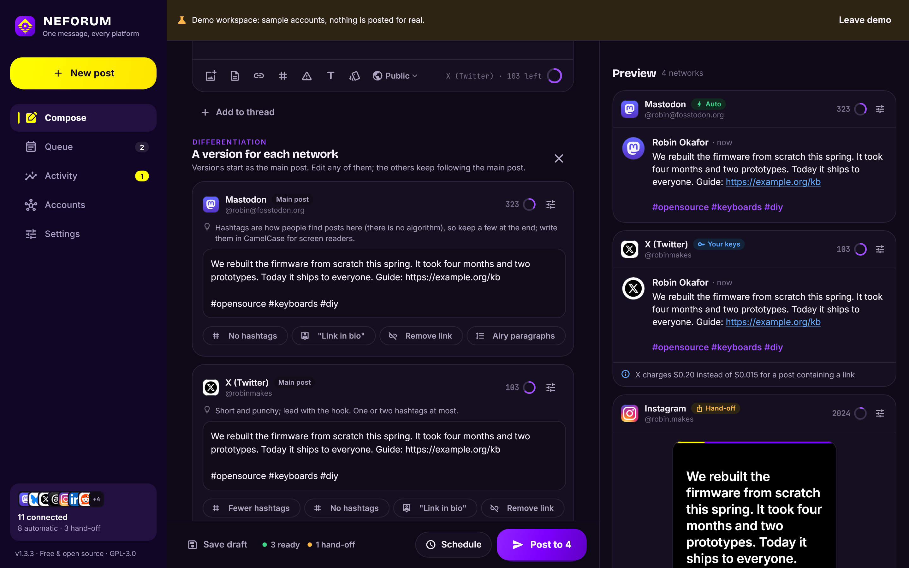
</p>

### Polls and quizzes

The **Poll** button adds a text poll, an image poll or a quiz for networks that have them (YouTube Posts today). The post text is the question; other networks get the post without the poll. In the hand-off every answer has its own copy button.

### Artwork for art sites

Turn on **Artwork** under Post to, and the post goes only to your art sites (DeviantArt, ArtStation, Behance, pixiv and the others below): the post's title and tags become the work's title and tags, and its text the description. Set the rating (general, mature or adult), mark work made with AI, and ask the sites not to train AI on it where they offer that. Art sites never receive text cards, and ordinary posts leave them out.

<p align="center">
  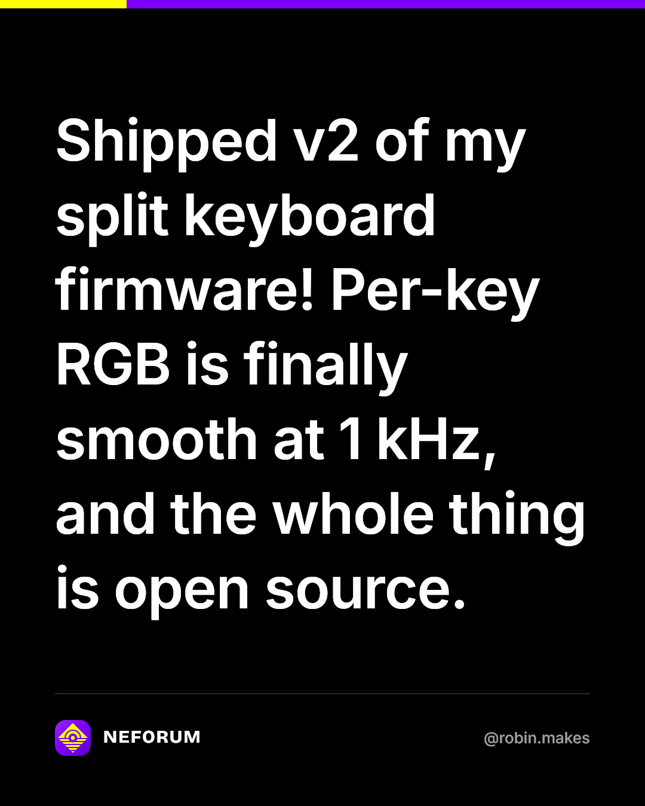
  &nbsp;
  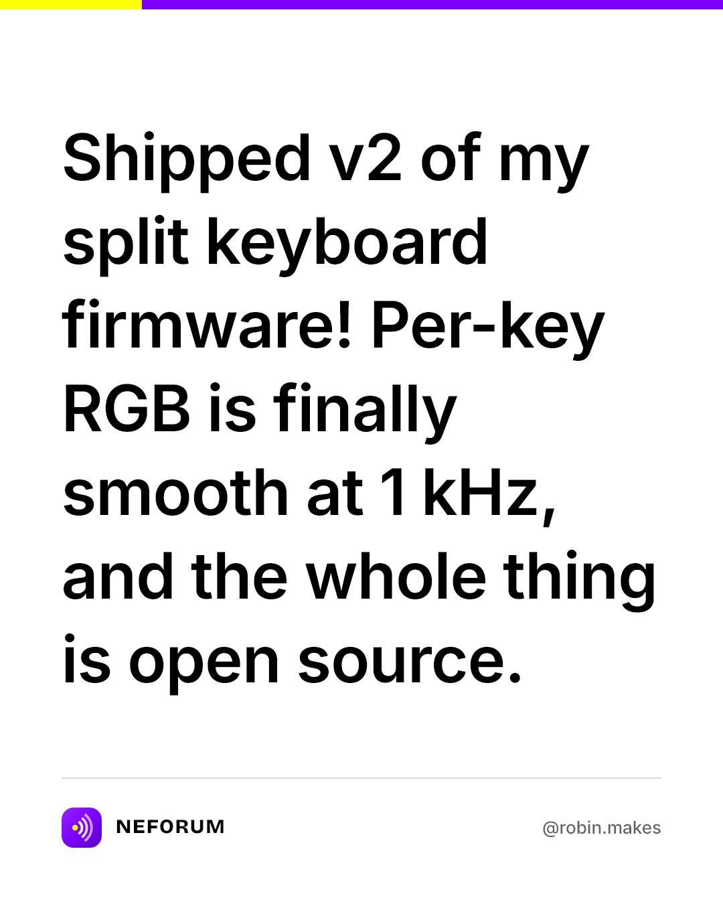
</p>

<p align="center">
  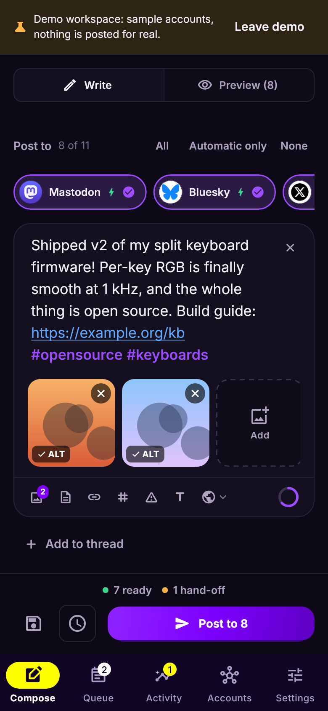
  &nbsp;
  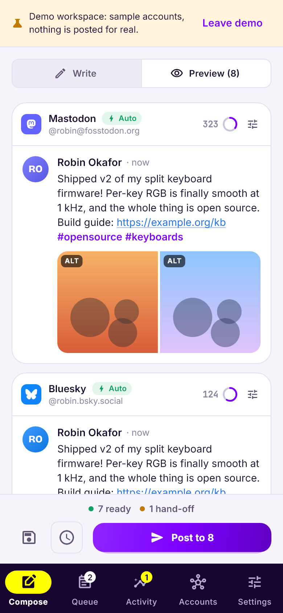
  &nbsp;
  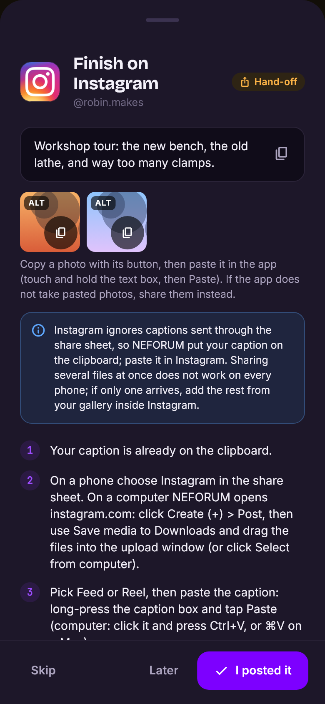
</p>

## Supported platforms

48 platforms. The full matrix (limits, media, quotas, scheduling) is in [docs/platforms.md](docs/platforms.md), generated from the code. Each platform has a step-by-step setup guide in [docs/platforms](docs/platforms), also shown inside the app.

- **Open networks:** Mastodon and compatible servers (Pleroma, Akkoma, GoToSocial, Friendica, Pixelfed, Mitra), Bluesky, Misskey / Sharkey / Firefish / Iceshrimp, Nostr, Lemmy, Matrix
- **Big platforms:** X, Threads, Facebook, LinkedIn, Reddit, Tumblr
- **Photo and video:** Instagram, TikTok, YouTube Posts (text and image posts on your channel's Posts tab), Pinterest, Snapchat
- **Video sites:** YouTube (videos and Shorts), Odysee (automatic through the LBRY desktop app, or hand-off), Rumble, BitChute
- **Messaging:** Telegram channels and groups, Discord (webhooks), WhatsApp
- **Blogs and newsletters:** WordPress, Ghost, WriteFreely / Write.as, Micropub (IndieWeb, Micro.blog), DEV, Hashnode, Substack Notes
- **Business:** Google Business Profile
- **Art and portfolios:** DeviantArt, Dribbble, Pixelfed, Flickr and Inkbunny automatically; Behance, ArtStation, Cara, pixiv, Itaku, Newgrounds, Fur Affinity, Weasyl, Ko-fi, Artfol and 500px by hand-off

### Honest limits (as of October 2026)

These come from the platforms, not from NEFORUM. The setup guides explain each one.

- **X:** new developer accounts are pay-per-use (about $0.015 per post, $0.20 for a post containing a link). No free tier. Hand-off is free.
- **Instagram and Threads (API mode):** Instagram needs a professional (creator or business) account. Both fetch media from a public web address, so you pick a media host in Settings (a free temporary one is built in). An optional fallback host takes over when the main one is down. Hand-off works with any account and needs none of this.
- **Facebook:** the API only posts to Pages you manage. Personal profiles use hand-off.
- **Connecting Meta (Facebook Pages, Instagram, Threads):** paste a token from Meta's own tools (Graph API Explorer, Instagram's **Generate token**, the Threads User Token Generator), so no redirect address has to be registered. NEFORUM turns it into a long-lived token and renews it. The setup guides follow Meta's documentation and its App Dashboard as of October 2026, step by step. Publishing your Meta app needs a privacy policy URL: enter NEFORUM's or publish your own from a template ([docs/meta-privacy-policy.md](docs/meta-privacy-policy.md)).
- **Tumblr without API keys:** text, link, quote and chat posts open Tumblr's share tool prefilled. Photo posts open prefilled too on a computer when you have set up a media host; otherwise NEFORUM opens a new photo post and saves the photos to Downloads to drag in. With the browser extension, Tumblr's full editor opens and is filled in, files included. Quote, chat and audio posts are a per-post choice.
- **TikTok:** apps TikTok has not audited can only post privately. Hand-off posts publicly from the TikTok app.
- **YouTube Posts** (the text and image posts on a channel's Posts tab) have no API at all, so they use hand-off. On a computer, the browser extension can post them for you when you turn on automatic posting. Your channel needs YouTube's advanced features turned on.
- **YouTube:** uploads from apps that have not passed Google's verification may be locked to private. Google's own pages disagree on whether that still applies, and NEFORUM cannot detect it. Hand-off always posts publicly.
- **Micropub (IndieAuth):** sign-in works on Windows and macOS. On phones, servers that check the app's client page can refuse it until the project publishes that page.
- **Hand-off** always needs one tap from you in the other app, so it cannot run unattended.

## Scheduling without a server

- **Platforms that can hold a post publish it themselves:** Mastodon (and Pleroma, Akkoma, Friendica, GoToSocial 0.20+), Facebook Pages, YouTube, Tumblr, WordPress and Ghost. NEFORUM hands them the post when you schedule it, so it goes out even if your device is off. Editing, rescheduling, publishing now or deleting the post in NEFORUM takes their copy back first. If that fails (offline, expired sign-in), NEFORUM tells you instead of pretending. Threads, private or unlisted YouTube videos, and times too close or too far out stay on the device.
- **Windows and macOS:** for everything else, NEFORUM keeps running in the tray (menu bar) when you close the window and posts on time. It can start when you sign in.
- **Android:** posts go out in the background within a few minutes of their time.
- **iPhone and iPad:** iOS does not let apps run on a timer. Networks that hold posts need nothing from the phone. For the rest you get a notification at the scheduled time; its **Publish now** button posts without opening the app.
- **Hand-off accounts** always get a "time to post" reminder.

## Sync without a server

Turn on **Settings > Sync** and every device reads and writes one encrypted file (`NEFORUM.neforumsync`, Argon2id + AES-256-GCM) in a folder your cloud app syncs, on a WebDAV server or in an S3-compatible bucket. Google Drive works directly on every device through its API with your own Google Cloud key (Google Drive's iPhone app does not let other apps pick its folders); phones and tablets can also pick a folder or the sync file in iCloud Drive, Dropbox and other cloud apps through the system file picker, or use WebDAV or S3. Each account, post and setting merges on its own; when both sides changed the same thing, a post that already went out beats an edit and the newest renewed sign-in wins. X and Tumblr, which kill the old sign-in on every renewal, get one renewer at a time, the renewed keys travel through the file, and a refused renewal re-reads the file and retries; or connect them with OAuth 1.0a keys, which never expire. A scheduled post is published by the device it was scheduled on (it has the photos), and another device steps in only when that one has been silent and the post is 30 minutes overdue. See [docs/sync.md](docs/sync.md).

## More screenshots

| | |
|---|---|
| 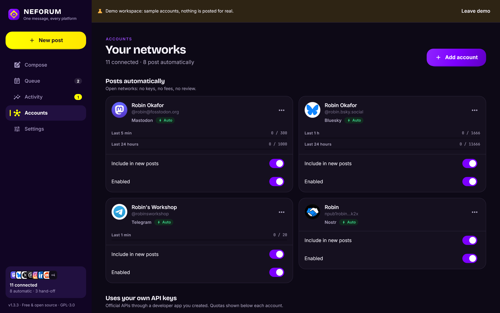 | 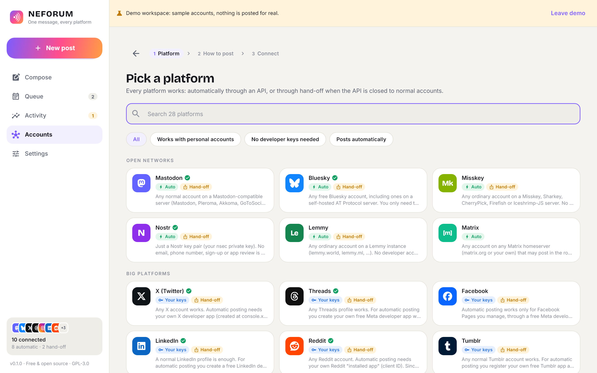 |
| 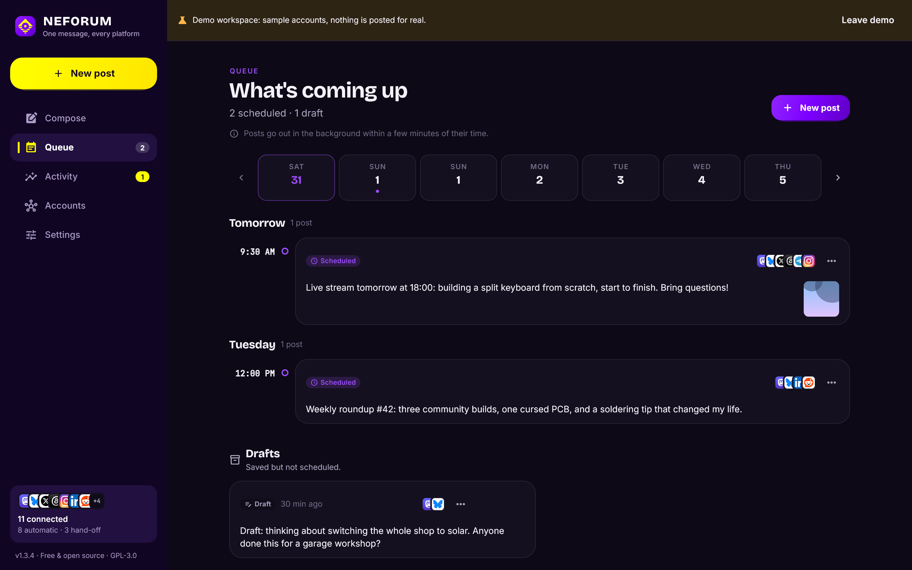 | 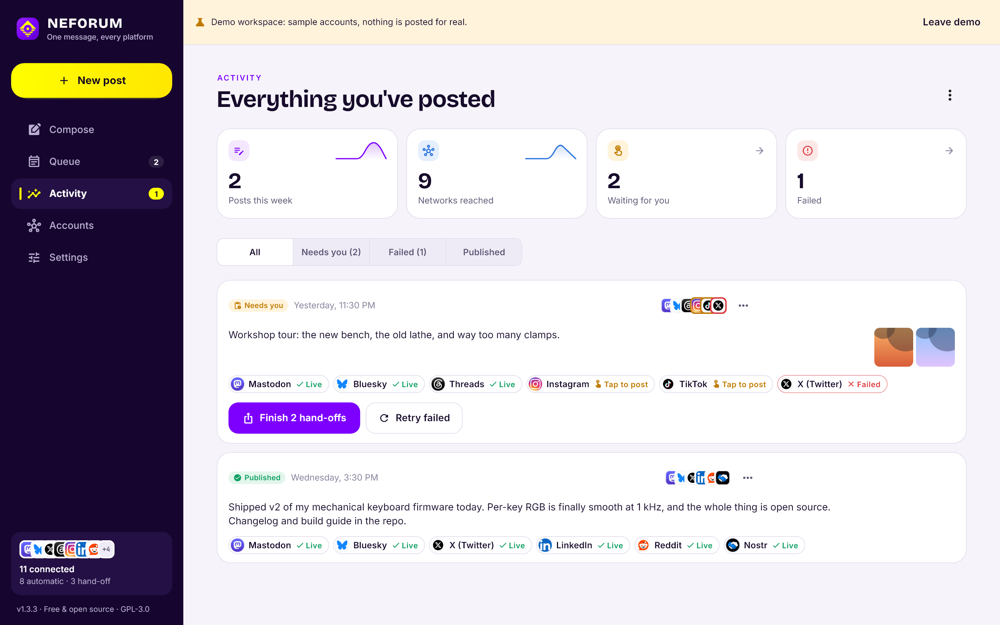 |
| 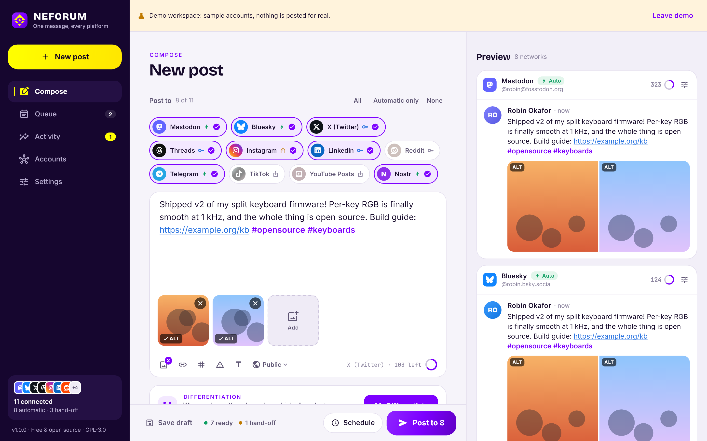 | 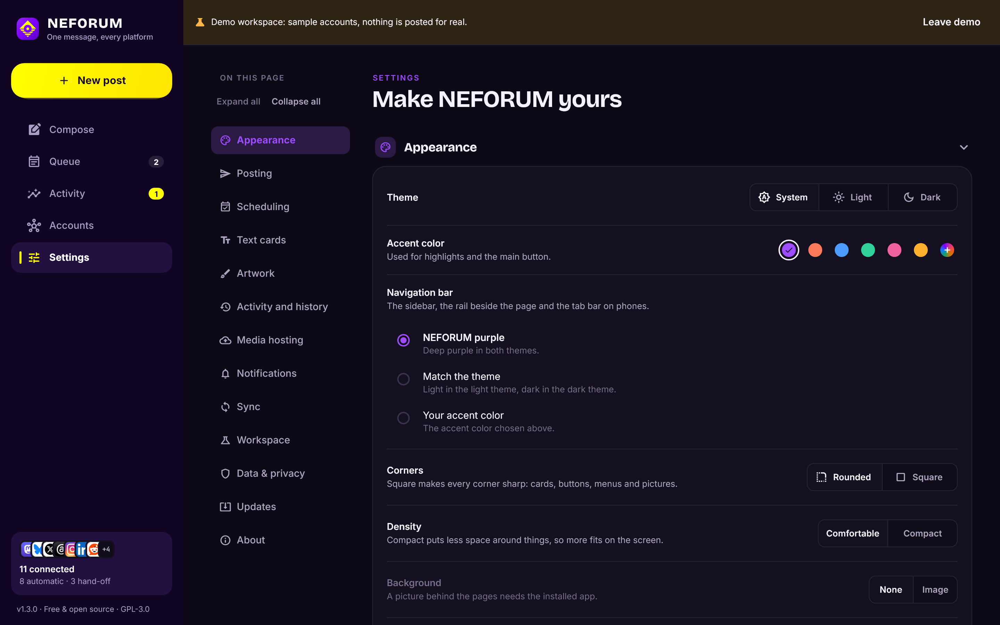 |

Light and dark themes, six accent colors, and layouts for phones, tablets and wide desktop windows. There is a demo workspace (Settings, then Workspace) to explore everything without connecting real accounts.

## Install

Download from **[neforus.com/neforum](https://neforus.com/neforum/)** or from the **[latest release](https://github.com/Neforuss/NEFORUM/releases/latest)** on GitHub. neforus.com keeps its own copy of every platform's download, so it works without GitHub.

| Platform | Download | How it installs |
|---|---|---|
| Windows | `NEFORUM-Setup-1.2.3.exe` | A normal installer: NEFORUM appears in the Start menu, in Windows search (also Win+R → `neforum`) and in Settings → Apps, and uninstalls cleanly from there. No administrator rights needed; "install for all users" is offered too. Windows 10 or 11, 64-bit. Or `neforum-windows.zip`: unzip and run `NEFORUM.exe`. |
| macOS | `NEFORUM-macOS.dmg` | Open it and drag NEFORUM onto Applications; it then shows up in Launchpad and Spotlight. Not signed by Apple yet, so the first time: right-click NEFORUM in Applications, then Open. macOS 10.15 or newer. (`neforum-macos.zip` has the same app. `NEFORUM-macOS-apple-silicon.dmg` and `NEFORUM-macOS-intel.dmg` are smaller downloads for one kind of Mac.) |
| Android | `neforum-android.apk` | Allow installing from your browser or file manager; NEFORUM then sits in the app drawer like any app. Android 7 or newer. Smaller downloads for one kind of phone: `neforum-android-arm64.apk` (nearly every phone), `neforum-android-armv7.apk` (older 32-bit phones), `neforum-android-x86_64.apk` (Chromebooks and emulators). |
| iPhone and iPad | `neforum-ios-unsigned.ipa` | Sign it with your own Apple ID (Xcode, AltStore or Sideloadly), or build from source in Xcode. |

The browser extension for Chrome and Firefox comes with the app (Settings → Browser extension → Show extension files) and is also in each release (`neforum-extension-chrome-*.zip`, `neforum-extension-firefox-*.zip`).

Every push builds all platforms with [GitHub Actions](.github/workflows/build.yml); a version tag (`v1.2.3`) publishes them as a release.
## Build from source

You need [Flutter 3.47](https://docs.flutter.dev/get-started/install) (Dart 3.13), plus the usual toolchain for your target: Android SDK, Xcode on a Mac for iOS and macOS, or Visual Studio 2022 with "Desktop development with C++" for Windows.

```bash
git clone https://github.com/Neforuss/NEFORUM.git
```

```bash
cd NEFORUM/apps/neforum_app && flutter pub get && dart run tool/sync_docs.dart
```

Then one of the commands below. Android and iOS builds take
`--dart-define=NEFORUM_MOBILE=true`, which leaves out the desktop tray code
(its FFI bindings break the release compiler for phones).

```bash
flutter build apk --release --dart-define=NEFORUM_MOBILE=true
```

```bash
flutter build windows --release
```

Then, for the Windows installer (needs [Inno Setup 6](https://jrsoftware.org/isinfo.php)):

```bash
iscc installer\neforum.iss
```

```bash
flutter build macos --release
```

```bash
flutter build ios --release --dart-define=NEFORUM_MOBILE=true
```

## Project layout

```
packages/neforum_core   Pure-Dart core: data model, 29 platform adapters, text
                        adaptation (counting, threads), quota tracking, OAuth,
                        media hosts, publish service, scheduler, encrypted
                        backup and sync. No Flutter.
apps/neforum_app        Flutter app: design system, screens, keychain storage,
                        sign-in, notifications, background work, tray.
docs/platforms          Per-platform setup guides (bundled into the app).
docs/research           The API research the adapters were built from.
docs/design/STYLE.md    Design rules for contributors.
```

Run the tests:

```bash
cd packages/neforum_core && dart test
```

```bash
cd apps/neforum_app && flutter test --exclude-tags screenshots
```

On a desktop, also run the real app with its native plugins (window, tray, keychain, notifications) against a throwaway data folder:

```bash
cd apps/neforum_app && flutter test integration_test -d windows
```

The core has over 1,000 tests that pin every adapter's requests and error handling against mocked APIs, including server-side scheduling and taking a scheduled post back. The app tests render every screen at phone, tablet, desktop and ultrawide sizes in both themes, and drive the main flows end to end, including text cards and platform-held schedules.

## Privacy

NEFORUM has no backend. It stores accounts, posts and settings in your app data folder and secrets in the OS keychain (Keychain on Apple platforms, Keystore on Android, DPAPI on Windows). Network traffic goes only to the platforms you post to and, if you pick them, the media host and fallback host you configure and the storage you sync through (which only ever receives the encrypted sync file). Settings, then Data and privacy, has three tools: **Move to another device** saves your accounts with their keys, media hosts, settings and drafts in one file encrypted with a passphrase (Argon2id and AES-256-GCM), which you carry to your phone or another computer yourself and import there (see [docs/backup.md](docs/backup.md)); **Export posts** saves a readable JSON file of your posts and account list without any keys; **Delete everything** removes all accounts, keys and posts from the device. Backup files you made are your own copies: deleting your data in NEFORUM does not delete them.

## License

NEFORUM is free software under the [GNU General Public License v3](LICENSE). Fonts: Inter, Bricolage Grotesque and JetBrains Mono (SIL Open Font License). Platform logos come from Font Awesome Brands (CC BY 4.0) and belong to their owners; NEFORUM is not affiliated with any of the platforms it posts to.
